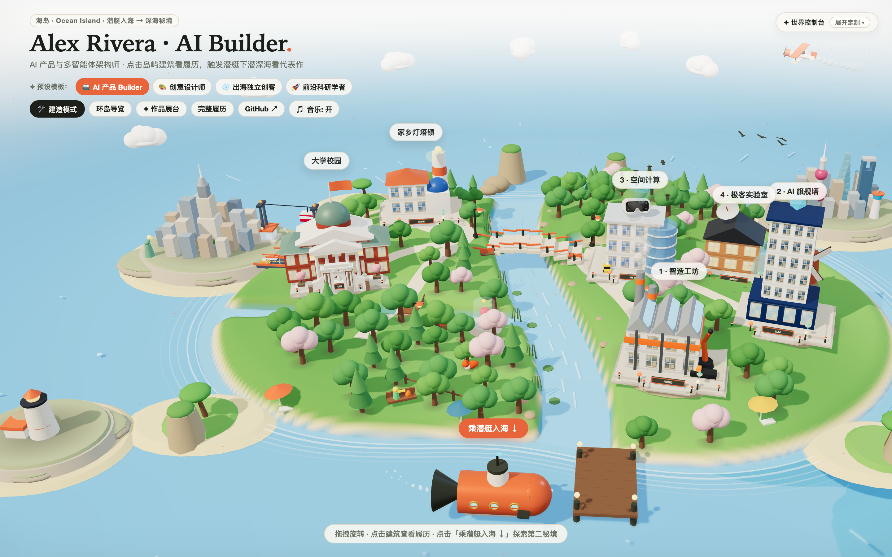
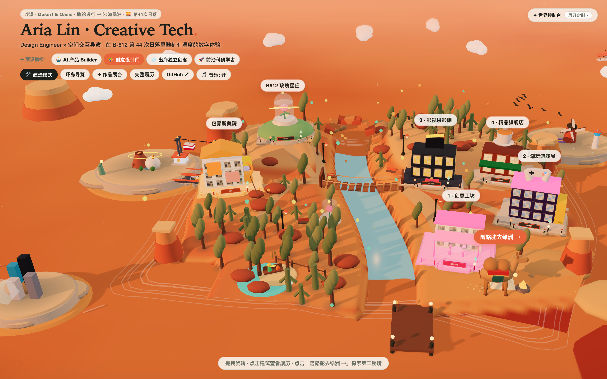
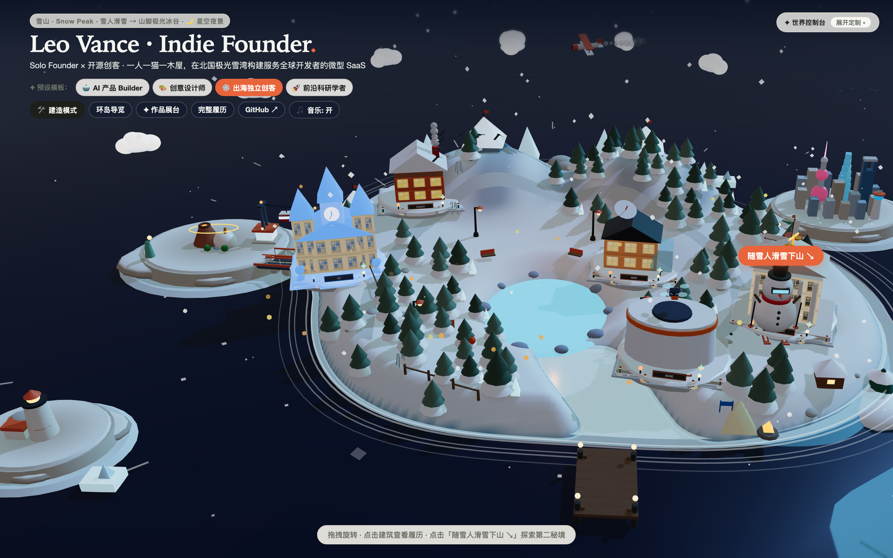
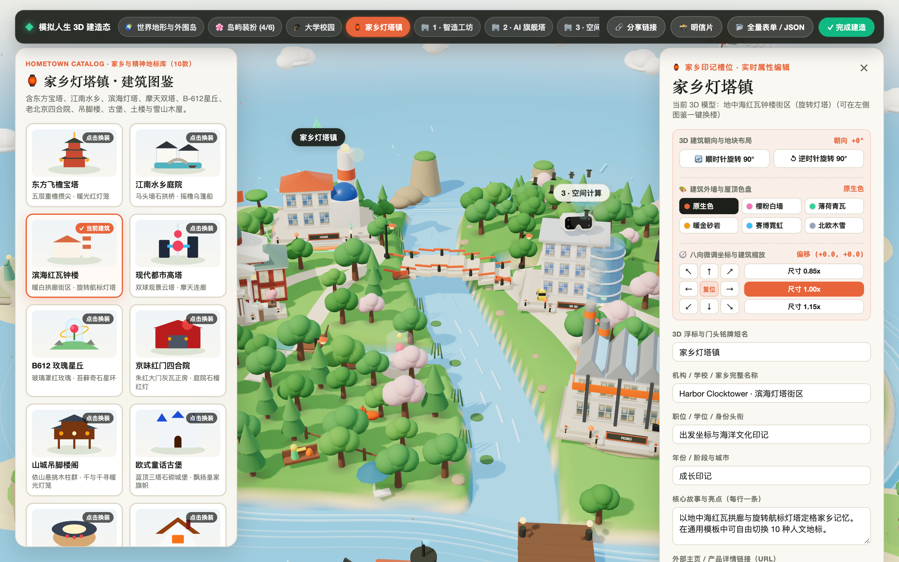

<div align="center">

# 🏝️ 3D Island Studio

**An Open-Source Low-Poly 3D Personal Website & Interactive Resume Builder**  
*Turn your resume and portfolio into an interactive, customizable 3D miniature world — zero 3D modeling required.*

[](./LICENSE)
[](https://www.typescriptlang.org/)
[](https://threejs.org/)
[](https://vitejs.dev/)
[](./CONTRIBUTING.md)

<h3>
  <a href="./README.md">🇨🇳 简体中文</a> · <strong>🇺🇸 English</strong>
</h3>

</div>

---

## 📖 Table of Contents

- [🌟 Why 3D Island Studio?](#-why-3d-island-studio)
- [🎬 Live 3D Render Previews](#-live-3d-render-previews)
- [✨ Core Features](#-core-features)
- [🚀 Step-by-Step Usage Guide (4 Workflows)](#-step-by-step-usage-guide-4-workflows)
  - [Workflow 1: Zero-Code In-Browser Builder + Instant Share Link (3 Mins)](#workflow-1-zero-code-in-browser-builder--instant-share-link-3-mins)
  - [Workflow 2: Fork & Deploy Your Own Standalone 3D Website (5 Mins)](#workflow-2-fork--deploy-your-own-standalone-3d-website-5-mins)
  - [Workflow 3: Generate Custom Alma Mater / Company 3D Landmarks with AI](#workflow-3-generate-custom-alma-mater--company-3d-landmarks-with-ai)
  - [Workflow 4: URL Parameters & Keyboard Shortcuts Cheat Sheet](#workflow-4-url-parameters--keyboard-shortcuts-cheat-sheet)
- [📐 `ProfileConfig` JSON Schema Reference](#-profileconfig-json-schema-reference)
- [🏛️ All 37 Built-in 3D Building Archetypes](#️-all-37-built-in-3d-building-archetypes)
- [💻 Local Development & Testing](#-local-development--testing)
- [📂 Project Structure](#-project-structure)
- [🙏 Inspiration & Credits](#-inspiration--credits)
- [🤝 Contributing & License](#-contributing--license)

---

## 🌟 Why 3D Island Studio?

Most personal websites and portfolios are flat, 1D scrolling pages. While bespoke 3D WebGL portfolios look magical, building one from scratch typically requires weeks of Three.js programming and Blender modeling.

**3D Island Studio** turns 3D personal world-building into a **parametric, zero-code experience**:
- **Sims-Style Visual World Building**: Map your **Alma Mater**, **Hometown / Spirit Landmark**, and **1–6 Career Stops** onto a stylized low-poly 3D island;
- **Dual-Realm Storytelling**: Explore your education and career buildings on the main island, then board a **Secret-Realm Carrier** (Submarine, Camel Caravan, Snowball Ski, Rocket, or Hot-Air Balloon) to travel to a secondary realm showcasing your flagship projects;
- **Ready in Minutes**: Paste your plain-text resume in the browser, swap 3D buildings with one click, share a serverless `#island=` URL, or export the JSON to deploy your own permanent site on Vercel / GitHub Pages.

---

## 🎬 Live 3D Render Previews

| 🌊 Ocean Archipelago · AI Product Builder (Noon) | 🏜️ Desert Canyon · Creative Tech Designer (Sunset) |
| :---: | :---: |
|  |  |
| **❄️ Polar Fjord · Indie Founder** (Starry Night) | **🛠 Sims-Style 3D Build Mode · 37 Building Archetypes** |
|  |  |

---

## ✨ Core Features

| Dimension | Built-in Capabilities |
| :--- | :--- |
| **🎭 4 Persona World Presets** | Instant 1-click switching between **🤖 AI Builder**, **🎨 Creative Designer**, **❄️ Indie Founder**, and **🚀 Research Scholar** worlds ([`src/data/personaPresets.ts`](./src/data/personaPresets.ts)) |
| **🌍 4 Biomes × 6 World Shapes** | **Ocean / Desert / Snow / Grassland** biomes × **Archipelago / B-612 Highland / Canyon Mesa / Alpine Valley / Crescent Bay / Floating Terraces** non-circular 3D terrains |
| **🚀 5 Secret-Realm Carriers** | **Submarine Dive** (Deep Sea), **Camel Caravan** (Desert Oasis), **Snowball Ski** (Aurora Valley), **Rocket Launch** (Low-Earth Orbit), and **Hot-Air Balloon** (Cloud Islands) |
| **🏛️ 37 Parametric 3D Buildings** | **10 Education** + **10 Hometown/Spirit Landmarks** + **17 Career HQs** — all procedurally built in Three.js with granite plinths, warm courtyard pathway lanterns, entrance canopies, and floating Plumbob crystals |
| **🛠 Sims-Style 3D Build Dock** | Click any building to swap its 3D model, rotate 90°, apply 6 roof tint palettes, scale (0.7×–1.45×), nudge X/Z coordinates, and place 6 island decor props (B-612 Rose, Fox Bench, Cherry Grove, Campfire Tent, Dutch Windmill, Pet Corgi) |
| **📄 Smart Resume Text Parser** | Paste any English or Chinese plain-text resume to automatically extract your name, tagline, university, companies, roles, and projects into a 3D island |
| **🎵 Dual-Engine Acoustic Radio** | Default-on lightweight stereo loop tracks (`morning-breeze` / `warm-sunset` / `starlight-ambient.mp3`) + real-time WebAudio harmonic synthesizer |
| **🔗 Serverless Share & Polaroid** | Encode your entire custom island into a `#island=<base64url>` share link (`?view=visitor`), or export a high-res Polaroid PNG postcard |

---

## 🚀 Step-by-Step Usage Guide (4 Workflows)

### Workflow 1: Zero-Code In-Browser Builder + Instant Share Link (3 Mins)

If you want to create and share your 3D island right inside the browser **without writing a single line of code**:

1. **Explore Persona Templates**: Click the 4 persona pills in the top-left **✦ Presets** strip to preview different biomes and career setups;
2. **Import Your Resume in 1 Click**:
   - Click **🛠 建造模式 (Build Mode)** in the top-left HUD → click **📂 全量表单 / JSON (Full Form / JSON)** in the bottom build dock;
   - Paste your resume text into the **📄 Paste Resume Text** box at the top of the drawer and click **✨ Parse & Generate My 3D Island**;
3. **Customize in Sims 3D Build Mode**:
   - Click any slot pill in the bottom dock (`🎓 Alma Mater`, `🏮 Landmark`, `🏢 Career 1–6`, `🌍 Terrain Shape`, `✨ Decor Props`) or click any 3D building directly on the island;
   - Pick from 37 architectural styles in the left catalog grid to swap the 3D building in real time;
   - Edit the organization name, role title, period, and highlights on the right inspector panel, or adjust rotation (`↻ 90°`), color tint, scale, and X/Z offset;
4. **Share or Export a Postcard**:
   - Click **🔗 Share Link** to encode your entire island into a `#island=...` URL in clean visitor mode (`?view=visitor`);
   - Click **📸 Polaroid** to download a high-resolution PNG postcard of your 3D world.

---

### Workflow 2: Fork & Deploy Your Own Standalone 3D Website (5 Mins)

If you want to host your own permanent 3D personal homepage on a custom domain (e.g., via Vercel, Netlify, or GitHub Pages):

1. **Fork and Clone the Repository**:
   ```bash
   git clone https://github.com/<your-username>/3d-island.git
   cd 3d-island
   npm install
   npm run dev
   ```
2. **Design Your Island & Copy the JSON**:
   - Open `http://localhost:5173`, enter **🛠 Build Mode**, and customize your profile, buildings, biome, and project booths;
   - Open **📂 Full Form / JSON** → scroll to **Import / Export JSON** → click **Copy JSON**.
3. **Update the Default Profile**:
   - Open [`src/data/defaultProfile.ts`](./src/data/defaultProfile.ts);
   - Replace `export const defaultProfile: ProfileConfig = { ... }` with your copied JSON, then commit and push:
     ```bash
     git add src/data/defaultProfile.ts
     git commit -m "feat: update my personal 3D island profile"
     git push
     ```
4. **Deploy for Free**:
   - Import your forked repo into **Vercel / Netlify / Cloudflare Pages** with Build Command `npm run build` and Output Directory `dist`. Your 3D personal website will be live in 30 seconds!

---

### Workflow 3: Generate Custom Alma Mater / Company 3D Landmarks with AI

Want a bespoke 1:1 3D replica of your actual university gate or company headquarters? We built an AI prompt generator tailored specifically to this codebase:

1. **Open the Custom Building Guide**:
   - Enter **🛠 Build Mode** and click the highlighted **✨ AI / Custom · Build Your Own Alma Mater / HQ** card at the bottom of the catalog (or inside the right Customize Drawer);
2. **Option A — Let AI (Claude Code / Cursor / Codex) Write the Three.js Code**:
   - Enter your target building name, category (`education / career / landmark`), and visual traits (e.g., *"Red brick triple arch gate, glass pyramid atrium, golden ginkgo trees"*);
   - Click **📋 Copy AI Modeling Prompt** and paste it into **Claude Code, Cursor, or Codex**;
   - The AI will automatically register the new `BuildingStyle` in [`src/schema/profile.ts`](./src/schema/profile.ts) and generate the procedural Three.js mesh in [`src/scene/buildings.ts`](./src/scene/buildings.ts) complete with granite plinth, pathway lights, and floating Plumbob!
3. **Option B — Request Bespoke Customization**:
   - Prefer not to touch code? Click **[💬 Open a Custom Building Issue](https://github.com/jasonz-ai/3d-island/issues/new?title=%5BCustom+3D+Building%5D+Request+Custom+3D+Landmark)** or reach out to the author [`@jasonz-ai`](https://github.com/jasonz-ai).

---

### Workflow 4: URL Parameters & Keyboard Shortcuts Cheat Sheet

| URL Query / Hash | Example | Description |
| :--- | :--- | :--- |
| `?preset=<id>` | `?preset=ai-builder`<br>`?preset=creative-designer`<br>`?preset=indie-founder`<br>`?preset=research-scholar` | Load one of the 4 curated persona worlds directly |
| `?view=visitor` | `?view=visitor` | **Clean Visitor Mode**: hides the Build Mode button and preset switcher bar — ideal for sharing on your resume or LinkedIn |
| `?build=1` | `?build=1` | Boot directly into the Sims-style 3D Build Mode dock |
| `#island=<base64url>` | `#island=eyJuYW1lIjoi...` | Serverless state hash that reconstructs a custom island directly from the URL |

---

## 📐 `ProfileConfig` JSON Schema Reference

Defined in [`src/schema/profile.ts`](./src/schema/profile.ts):

```jsonc
{
  "name": "Alex Rivera · AI Builder",
  "tagline": "AI Product & Multi-Agent Architect · Click buildings for resume, board carrier for projects",
  "github": "https://github.com/jasonz-ai/3d-island",
  "linkedin": "https://www.linkedin.com",

  // 1. Biome: "ocean" | "desert" | "snow" | "grassland"
  "biome": "ocean",

  // 2. Secret-Realm Carrier: "submarine" | "camel" | "snowball" | "rocket" | "balloon"
  "carrier": "submarine",

  // 3. 3D World Shape: "archipelago" | "b612-highland" | "canyon-mesa" | "alpine-valley" | "crescent-bay" | "floating-terraces"
  "worldShape": "archipelago",

  // 4. Time of Day: "day" | "sunset" | "night"
  "timeOfDay": "day",

  // 5. Weather Particles: "clear" | "sakura" | "snowfall" | "meteor" | "fireflies"
  "weather": "clear",

  // 6. Number of active career buildings on the island (1 to 6)
  "companyCount": 4,

  // 7. Island Decor Props: "b612-rose" | "fox-bench" | "cherry-grove" | "campfire-tent" | "dutch-windmill" | "pet-corgi"
  "decorProps": ["b612-rose", "fox-bench", "pet-corgi"],

  // 8. Buildings (1 "education" + 1 "landmark" + 1–6 "career" entries)
  "places": [
    {
      "id": "university",
      "name": "Alma Mater University",
      "short": "University",
      "kind": "education",          // "education" | "landmark" | "career"
      "style": "university",        // See all 37 styles in the table below
      "badgeText": "UNI",
      "tintPreset": "default",      // "default" | "sakura" | "mint" | "amber" | "cyber" | "nordic"
      "rotationOffset": 0,
      "buildingScale": 1.0,
      "offsetX": 0,
      "offsetZ": 0,
      "roles": [
        {
          "title": "B.S. in Systems Engineering & HCI",
          "period": "2016 – 2020",
          "location": "Global",
          "notes": ["Studied human-computer interaction, optimization, and interactive systems."]
        }
      ]
    }
  ],

  // 9. Secret-Realm Project Booths (up to 6)
  "projects": [
    {
      "id": "project-1",
      "name": "3D Island Studio",
      "tag": "Open-Source Engine",
      "boothStyle": "booth-holo",   // "booth-holo" | "booth-crystal" | "booth-monolith" | "booth-mech" | "booth-arcade"
      "link": "/demos/generic-showcase/index.html?template=ai-builder",
      "repoUrl": "https://github.com/jasonz-ai/3d-island",
      "summary": "Zero-code low-poly 3D personal website generator."
    }
  ]
}
```

---

## 🏛️ All 37 Built-in 3D Building Archetypes

Each `place.style` belongs to a strict category (`education`, `landmark`, or `career`):

<details>
<summary><strong>🎓 Education / Alma Mater (<code>kind: "education"</code> · 10 Styles) — Click to expand</strong></summary>

| `style` ID | Archetype Name | Visual Features & Signature Props |
| :--- | :--- | :--- |
| `university` | Classical Red-Brick Dome University | Triple-arch gate · Copper dome · Campus flag |
| `uni-gothic` | Twin-Spire Gothic Clocktower College | Mechanical clock face · Stained-glass rose window |
| `uni-modern` | Cantilevered Glass Institute of Tech | Floating glass box · Sun-tracking solar wings |
| `uni-academy` | Classical Courtyard Academy | Flying eaves courtyard · Bamboo lecture hall |
| `uni-observatory` | Astrophysical Observatory Institute | Silver observatory dome · Rotating radio telescope |
| `uni-art-bauhaus` | Bauhaus School of Art & Design | Mondrian primary-color grid facade · Sculpture plaza |
| `uni-gate-palace` | Imperial Gate & Grand Auditorium | White marble triple-arch paifang · Glazed roof hall |
| `uni-conservatory` | Classical Symphony Conservatory | Rotating golden harp sculpture · Acoustic glass dome |
| `ruc-mingde` | Red-Brick Humanities Complex | White stone colonnade · Engraved motto boulder & ginkgo trees |
| `unimelb-clocktower` | Victorian Sandstone Gothic Cloister | Sandstone clocktower · Pointed-arch cloister & jacaranda tree |

</details>

<details>
<summary><strong>🏮 Hometown & Spirit Landmarks (<code>kind: "landmark"</code> · 10 Styles) — Click to expand</strong></summary>

| `style` ID | Archetype Name | Visual Features & Signature Props |
| :--- | :--- | :--- |
| `pagoda` | Five-Tiered Classical Pagoda | Octagonal flying eaves · Warm red lantern courtyard |
| `watertown` | Jiangnan Canal Watertown | White walls & dark tiles · Stone arch bridge & wooden boat |
| `coastal-town` | Mediterranean Lighthouse Harbor | Terracotta roof arcade · Rotating coastal lighthouse beam |
| `metro-landmark` | Metropolis Twin-Sphere TV Tower | Futuristic observation spheres · Skybridge |
| `b612-rose-hill` | Asteroid B-612 Glass Rose Hill | Little Prince glass-domed red rose · Orbital star ring |
| `siheyuan-courtyard` | Traditional Courtyard Residence | Vermilion gate · Carved screen wall & pomegranate tree |
| `mountain-stilts` | Cliffside Stilted Pavilion | Multi-level timber stilts · Warm glowing lantern eaves |
| `euro-castle` | Fairytale Spire Stone Castle | Blue-coned triple towers · Moat bridge & royal banners |
| `tulou-roundhouse` | Circular Rammed-Earth Tulou | Iconic circular communal complex · Inner lantern ring |
| `snow-chalet-village` | Alpine Snow Chalet | Thick snow-draped timber cabin · Warm chimney & hearth |

</details>

<details>
<summary><strong>🏢 Career / Industry Headquarters (<code>kind: "career"</code> · 17 Styles) — Click to expand</strong></summary>

| `style` ID | Archetype Name | Visual Features & Signature Props |
| :--- | :--- | :--- |
| `tower` | AI & Cyber Neon Flagship Tower | Obsidian skyscraper · Animated holographic LED waterfall |
| `tech` | XR & Spatial Computing R&D Center | Giant rooftop XR headset · Holographic city sandbox |
| `factory` | Smart Robotics Giga-Factory | Sawtooth skylight roof · 6-axis industrial robotic arm |
| `studio` | Creative Design Glass Conservatory | Coral sunlit studio · Roundtable brainstorming bubbles |
| `biotech` | Terraced Biotech & Life Sciences HQ | Eco-terraced glass tower · Rotating DNA double helix |
| `game-arcade` | Pixel & Indie Game Studio | Neon purple facade · Floating giant game controller |
| `cloud-logistics` | Cloud-Native & Drone Logistics Hub | Aerial sky-ring runway · Hovering delivery drones |
| `indie-lab` | Indie Hacker Timber Garage Lab | Warm timber workshop · Rotating deep-space dish |
| `medical-center` | Modern Medical & Health Center | Curved white hospital wing · Rooftop rescue helipad |
| `law-palace` | Neoclassical Law & Finance Palace | Marble colonnade · Rotating golden scales of justice |
| `film-stage` | Film & Virtual Production Stage | Giant animated clapperboard · Camera crane & spotlights |
| `coffee-roastery` | Specialty Coffee Roastery Flagship | Steaming giant latte-art cup on roof · Striped awning |
| `xiaomi-park` | Twin-Bridge Tech Campus HQ | Slate-blue twin glass towers · Orange rooftop emblem & track |
| `jd-hq` | Triple-Tower Skybridge Mega HQ | Three towers linked by high-altitude skybridges · Chrome mascot |
| `bytedance-hq` | Cantilevered Digital Plaza | Offset cantilevered glass blocks · Sky garden & dynamic light bars |
| `taikang-tower` | CBD Diagrid Financial Skyscraper | Champagne-gold diagrid facade · Illuminated crystal crown |
| `cscec-tower` | Exoskeleton Blue-Cube Tower | Sapphire glass curtain wall · X-braced steel frame & 3D blue cube |

</details>

---

## 💻 Local Development & Testing

### Prerequisites
- **Node.js** `>= 20.0.0`
- **npm** `>= 10.0.0`

### Commands

```bash
# 1. Install dependencies
npm install

# 2. Start Vite dev server (http://localhost:5173)
npm run dev

# 3. Run Vitest contract & geometry test suite
npm test -- --run

# 4. Build production bundle (outputs to dist/)
npm run build

# 5. Preview production build locally
npm run preview
```

---

## 📂 Project Structure

```text
3d-island/
├── public/
│   ├── audio/                    # 3 lightweight stereo ambient loop tracks (.mp3)
│   ├── logos/                    # Generic geometric vector emblems (.svg)
│   ├── preview/                  # 4 high-res WebGL render screenshots
│   └── demos/
│       └── generic-showcase/     # Interactive in-island showcase & JSON schema generator
├── src/
│   ├── data/
│   │   ├── defaultProfile.ts     # Default open-source starter profile (Alex Rivera)
│   │   ├── personaPresets.ts     # 4 curated 1-click persona world templates
│   │   └── resumeParser.ts       # Plain-text resume parser (EN/ZH)
│   ├── schema/
│   │   └── profile.ts            # ProfileConfig types, 37 building styles, validation & #island= codec
│   ├── scene/
│   │   ├── world.ts              # Three.js scene controller, camera rig, lighting & guided tour
│   │   ├── layout.ts             # 6 non-circular heightfields, SDF collision avoidance & sightlines
│   │   ├── terrain.ts            # 4 biome terrain meshes, bridges, boardwalks, props & foliage
│   │   ├── buildings.ts          # 37 procedural low-poly 3D buildings & 5 project booths
│   │   ├── carriers.ts           # 5 secret-realm transition carriers & spring animations
│   │   └── sound.ts              # UI interaction sound synthesis
│   ├── ui/
│   │   ├── appUi.ts              # Top-left HUD, Sims 3D build dock, AI prompt modal & drawers
│   │   └── soundscape.ts         # Dual-mode ambient music player (HTMLAudio + WebAudio synth)
│   ├── main.ts                   # Entry point & URL parameter routing
│   └── style.css                 # Responsive UI styling
├── tests/
│   └── island.test.ts            # Automated Vitest suite (10 contract gates)
├── README.md                     # Simplified Chinese Documentation
├── README.en.md                  # English Documentation
├── CONTRIBUTING.md               # Bilingual Contributing Guide
└── LICENSE                       # MIT License
```

---

## 🙏 Inspiration & Credits

- **Original Creative Inspiration**: The initial spark for this project came from **[Joshua's World](https://joshuas.world/)** — seeing how a personal portfolio could be reimagined as a charming, explorable 3D miniature island inspired us to build this parametric, zero-code open-source engine from scratch so anyone can create their own 3D world;
- **Visual & Interaction Aesthetics**: Inspired by *The Sims*, *Monument Valley*, and the classic isometric low-poly diorama tradition in the creative WebGL community;
- **Open-Source Ecosystem**: Built on top of [Three.js](https://threejs.org/), [Vite](https://vitejs.dev/), and [TypeScript](https://www.typescriptlang.org/).

---

## 🤝 Contributing & License

Contributions, issues, and feature requests (new **3D building archetypes**, **biome palettes**, **persona templates**, or **UI improvements**) are warmly welcome! Please check [`CONTRIBUTING.md`](./CONTRIBUTING.md) for details.

Licensed under the [MIT License](./LICENSE). If you find this project helpful, please consider giving it a ⭐ **Star**!
